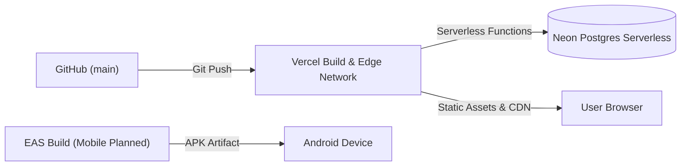

# Deployment Strategy & Infrastructure

## Production Architecture



## Web Application Deployment

- **Platform**: Vercel (Next.js App Router).
- **Branch**: `main` branch pushes automatically trigger production deployments.
- **Node.js Runtime**: Node 20+.
- **Build Command**: `next build` (using Turbopack).
- **Static vs Dynamic**:
  - Dynamic routes: Pages requiring live DB queries (`/`, `/scores`, `/tracker`, `/recent`, `/analysis`, `/settings`) use `export const dynamic = 'force-dynamic'`.
  - Static routes: Documentation (`/docs`, `/docs/dev`) and song cache routes are statically rendered or cached via ISR.

## Configuration & Secrets

All production secrets are managed in the Vercel project environment variables:

| Variable | Scope | Description |
|---|---|---|
| `DATABASE_URL` | Production, Preview | Neon Postgres connection string with connection pooling enabled (`-pooler` endpoint) |

> [!NOTE]
> `next.config.mjs` configures `typescript: { ignoreBuildErrors: true }` to prevent script/utility type warnings from failing production builds.

## Database Migrations

- Database schema is managed via **Drizzle ORM**.
- Direct schema synchronization command:
  ```bash
  npm run db:push
  ```
- No downtime or migration lockouts on serverless Neon Postgres.

## Mobile Application Deployment (Planned)

- **Framework**: Expo SDK 52 with React Native.
- **Build System**: Expo Application Services (EAS Build).
- **Target**: Android APK / AAB.
- **Distribution**: Direct APK sideloading and GitHub releases (no Play Store review friction for scraper).
- **Updates**: EAS Update for over-the-air (OTA) JavaScript bundle patches.
