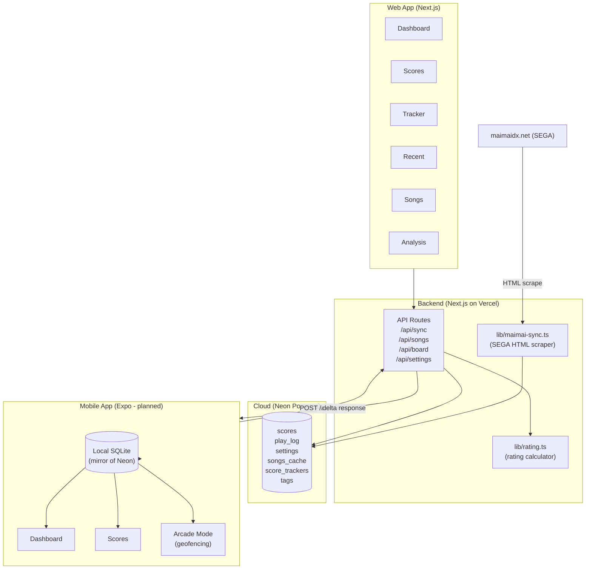

# System Design & Architecture

## Architecture Overview



## Current Tech Stack (Web — Implemented)

| Layer | Technology |
|---|---|
| Framework | Next.js 16.2.9 (App Router, Turbopack) |
| Language | TypeScript 5 |
| Database | Neon Postgres (serverless) via Drizzle ORM |
| Scraping | Cheerio + node-html-parser + fetch-cookie + tough-cookie |
| Styling | Tailwind CSS v4 |
| Animations | Framer Motion |
| Icons | Lucide React |
| Deployment | Vercel |
| Song data source | dxrating community API (maimaidx.lol) |

## Planned Tech Stack (Mobile — Phase 1+)

| Layer | Technology |
|---|---|
| Framework | Expo SDK 52 + Expo Router v4 |
| Language | TypeScript (shared with web) |
| Local DB | expo-sqlite + Drizzle ORM |
| State | Zustand |
| Animations | Reanimated 3 + Moti |
| Session detection | expo-location + expo-task-manager |
| Notifications | expo-notifications |
| Build | EAS Build (Android APK) |

## Data Models

### Core entities (Drizzle schema — `lib/db/schema.ts`)

- **scores** — best score per (song × difficulty × type). Unique constraint on title+diff+type.
- **play_log** — chronological recent 50 plays from /record/. Includes note details (break, tap, etc.).
- **songs** — full song metadata cached from dxrating API. ~15k rows.
- **settings** — key/value store (SEGA credentials, profile info, region).
- **score_trackers** — rating target goals per chart.
- **tags / tag_songs** — personal tag system (groups + tags + chart assignments).
- **tracker_lists / list_items** — custom song folders for the Board.
- **arcade_sessions** — *(planned mobile)* session records with start/end, location, rating delta.
- **sync_meta** — *(planned mobile)* SQLite-only sync timestamps.

### Difficulty model

```
BAS → ADV → EXP → MAS → REMAS → UTAGE
```
Colors: `#3fb950` / `#d4a017` / `#f64861` / `#9f51dc` / `#e4b7eb` / `#bf1b5e`

UTAGE charts have string levels (e.g. "13?", "光") not float levels. Parse with `lev_utage` field, never `.toFixed(1)`.

### Rating formula

```
rating = floor(internal_level × factor(achievement) × 10000) / 10000
```

Rating pool: B15 (new songs ≥ 2nd most recent major version) + B35 (older songs).
New pool threshold computed by `detectCurrentVersion(songs)` + `getNewPoolThreshold()`.

## API Routes

| Route | Method | Description |
|---|---|---|
| `/api/sync` | POST | Scrapes maimaidx.net, writes to Neon |
| `/api/songs` | GET | Returns full song list (1h cache) |
| `/api/settings` | GET/POST | Read/write app settings |
| `/api/board` | GET/POST | Tracker board CRUD |
| `/api/recent-plays` | GET | Returns play_log |
| `/api/tags/*` | GET/POST | Tag management |
| `/api/validate-session` | GET | Check SEGA cookie validity |

## Key Design Decisions

| Decision | Choice | Rationale |
|---|---|---|
| Scraping server-side only | Yes | Never ship scraping logic in mobile APK |
| Local-first mobile | SQLite mirror | Instant reads, offline support |
| Monorepo | pnpm workspaces | Share types + rating logic + DB schema |
| No public multi-user | Single-user | No auth system needed; simpler infra |
| UTAGE as a full Difficulty | Yes | Separate color/level handling from standard difficulties |
| TypeScript `ignoreBuildErrors` | Yes | Pre-existing `any` types in scripts/utilities; build must not fail |

## Non-Functional Requirements

- **Performance:** Dashboard cold load <500ms web, <200ms mobile (SQLite)
- **Offline:** Mobile app fully functional without network after first sync
- **Accuracy:** Rating calculation matches official site within ±1 point
- **Security:** SEGA credentials stored in Neon `settings` table (server-side only), never in client JS bundle
